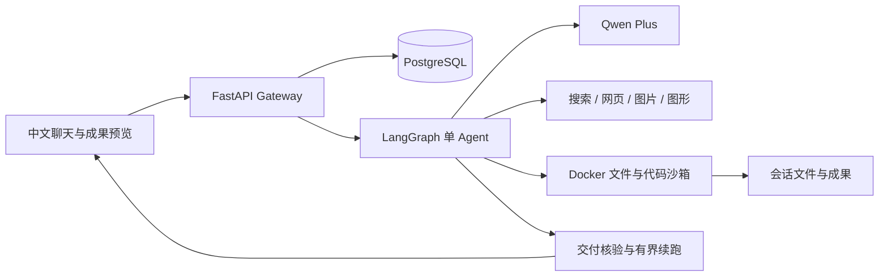

# 渝研 Agent 架构

浏览器 Next.js 聊天工作台通过同源代理访问 FastAPI Gateway。Gateway 完成身份、会话和运行控制，LangGraph 编排 Qwen 与白名单工具；PostgreSQL 保存用户、会话、检查点和运行事件。Docker AIO 沙箱承担代码执行，产物目录按用户、会话隔离。

## 本轮执行控制

`agent-ops/delivery_guard.py` 通过框架现有配置中间件机制接入，不改写上游 Agent 循环。每轮保存已展示文件基线；对明确生成文件的用户请求检查当前会话内的新成果、非空文件和展示状态。显式文件名必须齐全。缺少成果时最多续跑两次；仍不满足，使用框架已有错误标记结束，不能把运行状态success当作交付成功。

请求中的自然语言识别是有界规则，不声称理解任意表达；检查文件交付也不代表内容语义正确。澄清工具、正在进行的工具调用、模型错误和预算停止交由原框架处理。控制提醒仅进入下一次模型请求，不写入用户聊天历史。

`research_policy.py` 的普通事实查证策略通过同一配置机制接入，使其请求调整真实生效。旧观察型扩展包装器会保留原请求，不适合用于改变模型请求；因此不再通过该包装器加载执行策略。

## 配置与数据

- `agent-ops/config.qwen.yaml`：模型、工具、数据库、沙箱和预算。
- `agent-ops/extensions.json`：当前中间件与禁用的可选技能。
- `agent-ops/.env.local`：本机私有凭据，不提交。
- `agent-platform/.deer-flow`：私有上传、成果和用户运行状态，不提交。
- 默认不加载银行业务插件；历史研究代码独立保留。

## 能力边界

模型解释不代替工具结果；搜索失败不证明事物不存在。实际模型调用仍可能错误，明确失败与可继续任务比伪造成功更重要。没有公共生产服务、全面安全审计或任意复杂任务正确率承诺。
