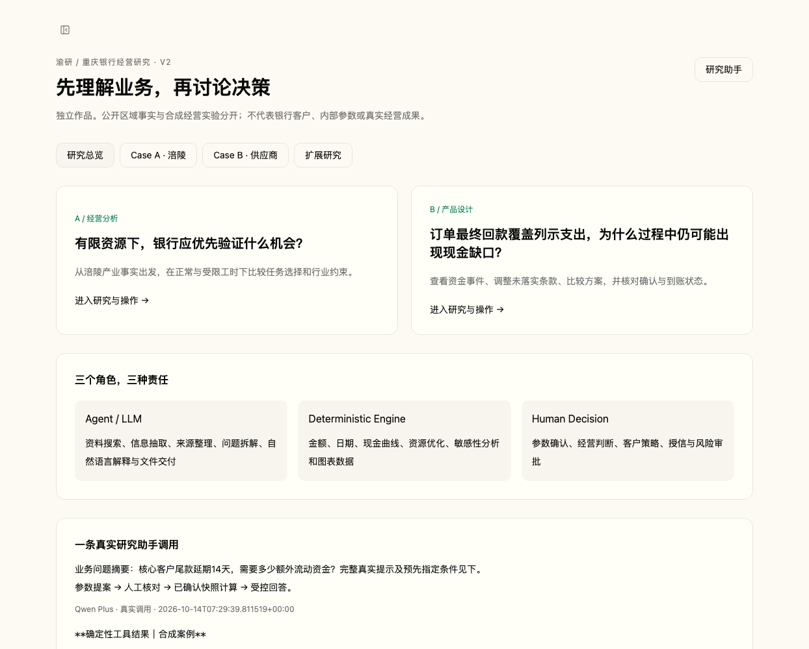
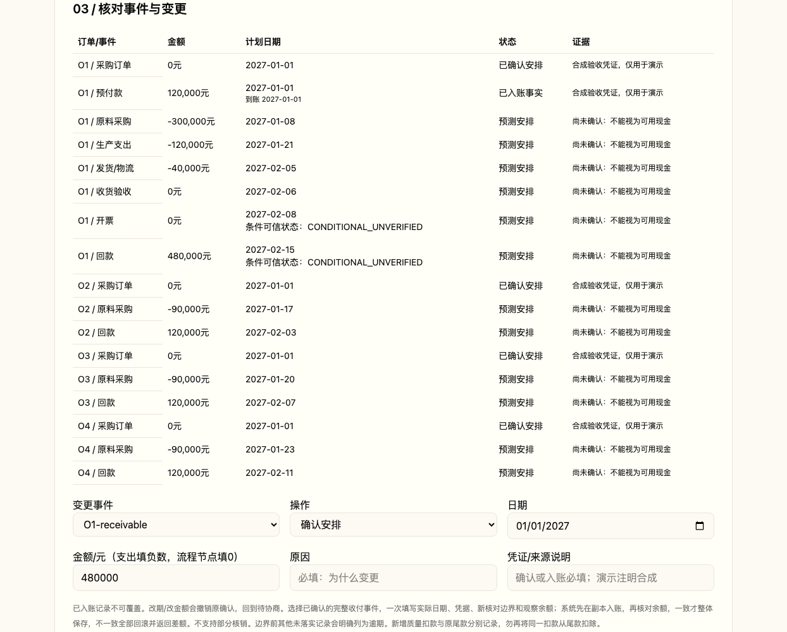

# 三分钟看懂渝研

先看业务，再决定是否读代码。这里的截图与录屏均来自本机真实 Final Release 页面；没有 mock 接口、改写页面数据或图像拼接。为保护私人会话，只截取研究区域。

## 0:00–1:00 · Case A：涪陵县域经营分析

**问题：客户经理的工时有限，应先验证哪些经营机会？**

页面把 **FACT**（公开区域事实）与 **ASSUMPTION**（客群数量、单价、采用率、成本、工时）分开。区域产业方向用于提出待验证问题，不用于推断银行客户占比。

同样 **10 万元余额**，仅改变业务特征，优先动作即可不同：

| 隔离变量的合成对照 | 优先动作 | 假设年增量净贡献 |
|---|---|---:|
| 年交易 10,000 笔 | 结算深化 | 5,650 元 |
| 可授权代发员工 500 人 | 代发 / 支付场景 | 5,350 元 |
| 合格供应链连接 30 个 | 供应链上下游连接 | 7,200 元 |
| 既有关系贡献 30,000 元、流失情景 50% | 客户经营维护 | 5,850 元 |

这是现有 [同余额反事实测试](agent-ops/test_fuling_v2.py) 的隔离实验，**不是截图中默认 120 户的实际分布，也不是一个新增 UI 功能**。其他非余额业务驱动置零，25 小时内选择一个动作。单价与采用率均为研究假设。

下图是真实页面中选中动作的业务驱动、公式、成本后的净贡献、工时、待验证材料与停止条件：

| 可用增量工时 | 无行业上限 | 单行业不超过实际分配工时 25% |
|---|---:|---:|
| 正常情景 600h | 138,451.20 元 | 138,451.20 元 |
| 受限情景 150h | 45,027 元 | 44,205 元 |

**822 元 = 45,027 − 44,205，是合成模型的机会成本输出，不是银行真实损失或收益。25% 是资源分散研究假设，不是监管、授信或风险限额。** 2100 小时基础维护也是独立假设，并非客户字段汇总。约束不绑定时结果相同，不为制造故事而调参。

[▶ 约 68 秒真实操作视频](docs/media/fuling.mp4) · [研究报告](docs/reports/fuling-research.pdf)

## 1:00–2:10 · Case B：汽摩供应商资金管理

**问题：订单最终回款覆盖列示支出，为什么过程中仍可能出现现金缺口？** 四笔合成订单回款 96 万元、列示支出 73 万元；23 万元只是输入收支差额，**不能称为会计利润**。

基线峰值缺口 **49 万元**，负余额 **38 天**。C1 回款延后 14 天时，峰值仍为 49 万元，负余额延长至 **52 天**。缺口规模与持续时间是不同问题；缺口不是授信额度。

| 合同类型 | 本例中如何推导预计回款 |
|---|---|
| `AFTER_INVOICE`（O1） | 验收 → 2 天后预计开票 → 开票后 7 天预计回款 |
| `FIXED_DATE`（其他订单） | 按固定日期；验收变化不会误改固定回款日期 |

以上天数是合成合同假设。依赖变化只重推 `PROJECTED` 日期，不自动升级 `CONFIRMED` / `POSTED`；争议沿依赖影响预测可信状态。

| 状态 | 含义 | 是否是实际现金 |
|---|---|---|
| PROJECTED | 预计发生 | 否 |
| CONFIRMED | 安排已确认 | 否 |
| POSTED | 有凭据的实际收付 | 是；不可覆盖 |

**一次提交“实际收付 + 新核对边界 + 观察余额”**：事务副本先应用收付，再与观察余额核对。录像中先故意填错余额，系统返回差额、全部回滚、版本仍为 2；改为正确的 −100,000 元后才整体提交至版本 3。该负余额仅为合成演示。没有半笔入账，不支持部分核销。

[▶ 约 78 秒 Supplier + 参数确认视频](docs/media/supplier-ai.mp4) · [研究报告](docs/reports/supplier-research.pdf)

## 2:10–3:00 · AI：算对，不等于答对

`用户问题 → LLM结构化提案 → 参数确认 → deterministic tool → 结果 → LLM解释`

**Numerical correctness ≠ Semantic correctness**

用户问 **C1 / 14 天**，如果系统却算 **ALL / 30 天**，即使计算器没有算错，回答仍然错。ScenarioRequest 将 request_id、case_id、customer_id、base_version、延期、折扣、费用、预付及确认状态绑成同一快照。工具只消费最终确认参数，修改输入后旧结果失效。

录像真实演示了输入改变后旧结果消失，再确认 ALL / 30 天得到另一个情景（53 万元 / 68 天），不能冒充原请求。该录像操作的是人工参数确认界面，**没有伪装新的模型调用**。

下图展示的是已有真实 Qwen 调用的公开受控回答。原用户问题已预先指定 C1 / 14 天和不考虑成本；模型仍留空三项成本，验收程序补零并确认。不能称为模型自主完成全部抽取。金融回答由确定性结果及模板约束，LLM 不自行计算金额。

[查看脱敏 Trace](agent-platform/frontend/public/research/trace.json)：真实用户提示、人工策略摘要、原始模型提案、验收修正、确认快照、工具参数/结果与受控回答；不含完整 provider/system context。

**继续复核：[架构](ARCHITECTURE.md) · [复算](REPRODUCIBILITY.md) · [数据边界](DISCLAIMER.md)**
