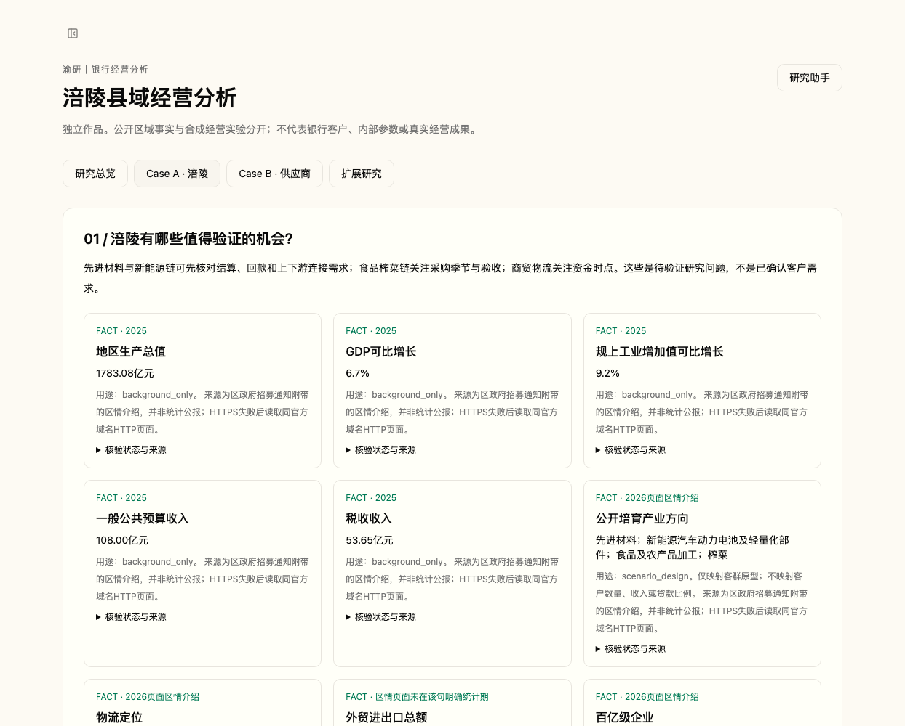
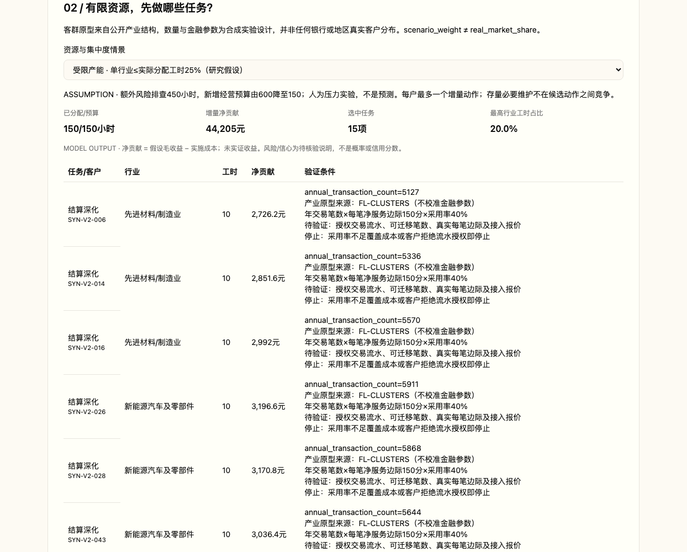
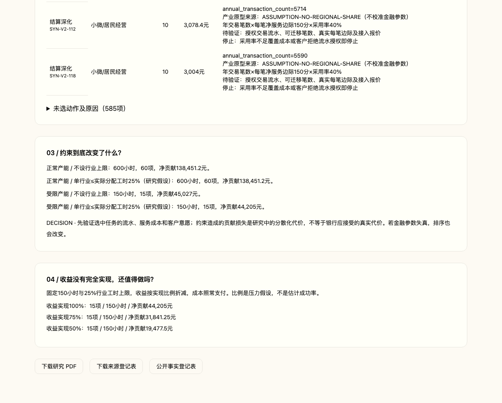
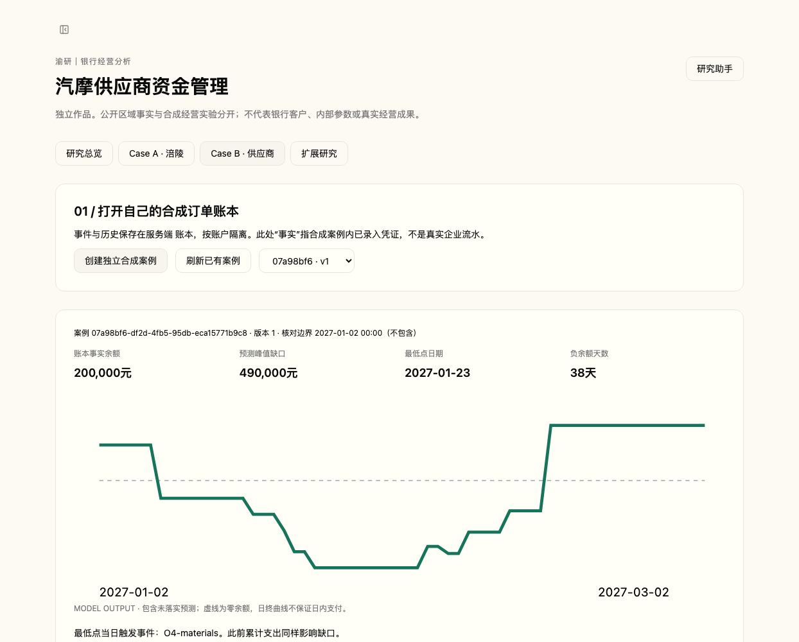
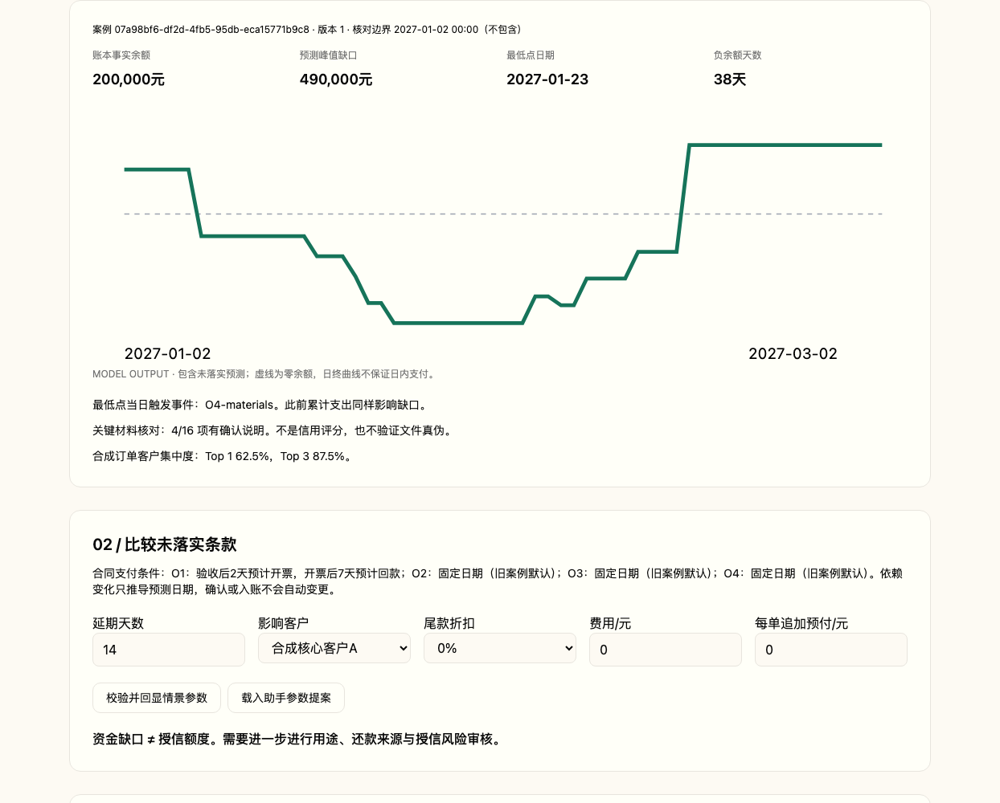
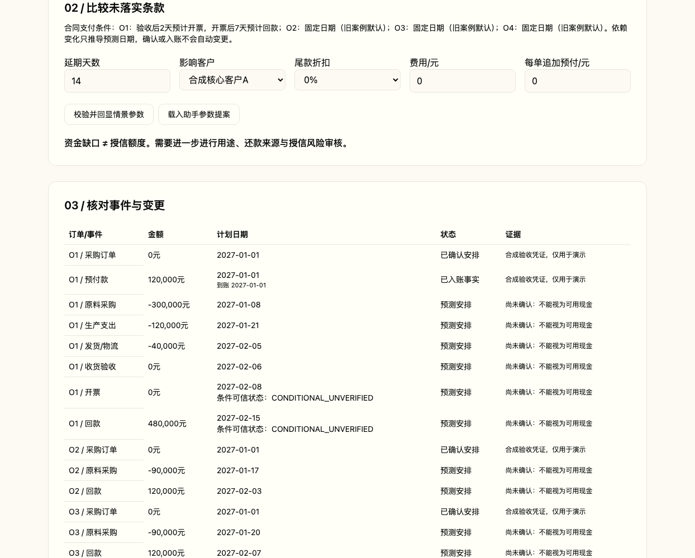
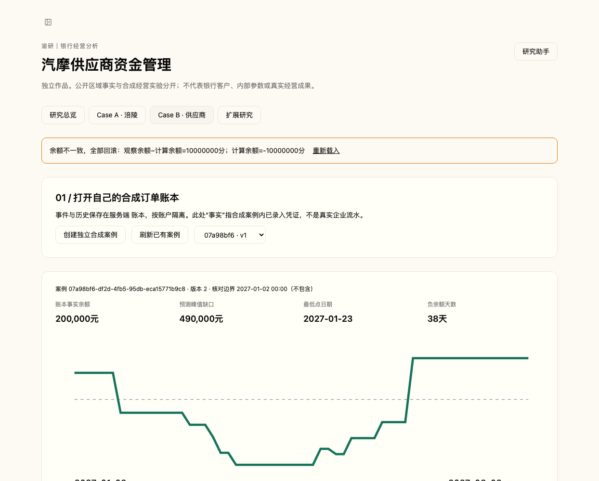
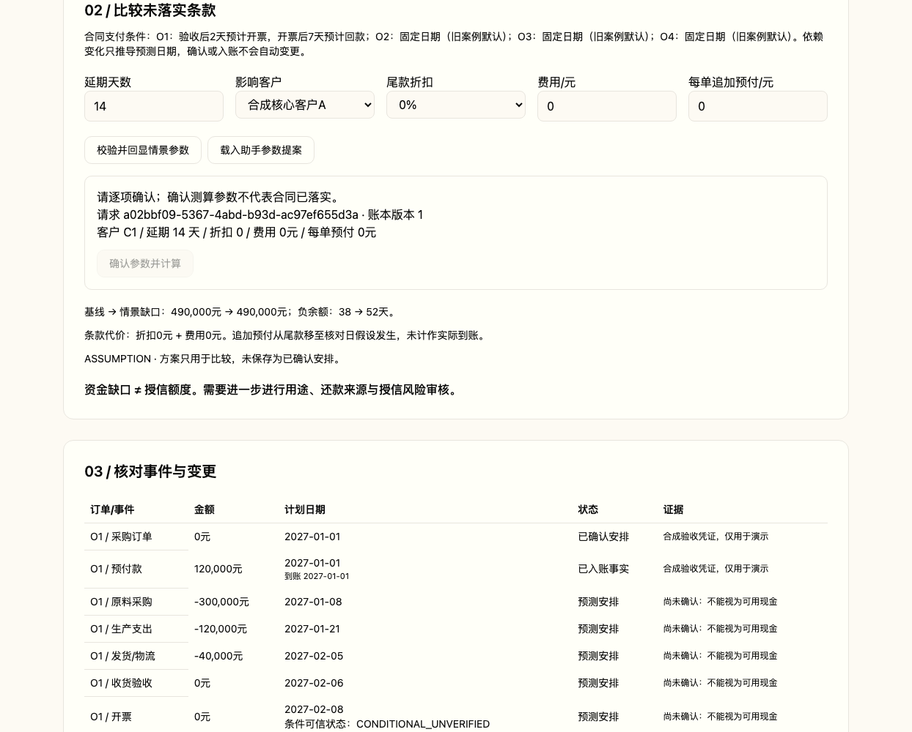
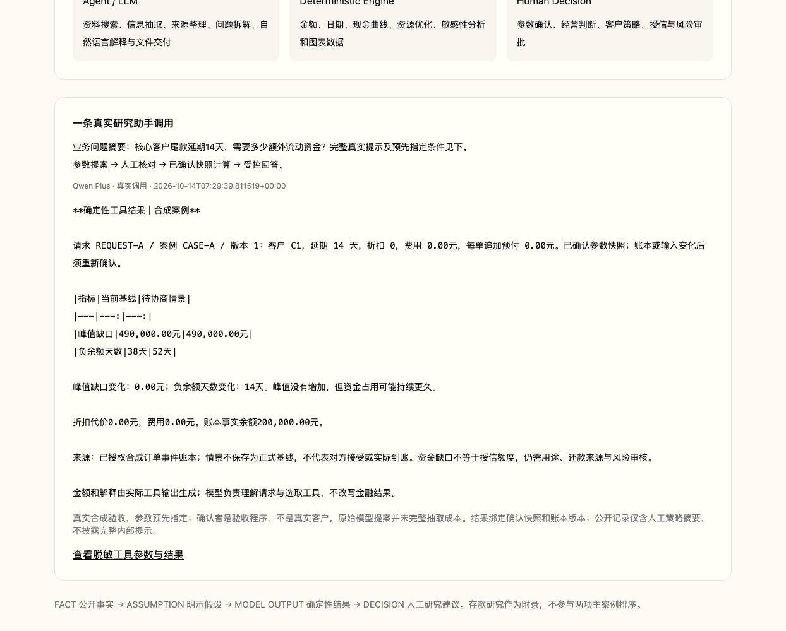

# 两个银行业务案例

[打开项目展示页](https://sgyuhan23.github.io/yuyan-bank-research/) · [返回项目主页](README.md)

## 县域客户经营

### 客户经理时间有限，先跟进谁？

不同客户适合做的事情不一样。交易频繁的客户可能更值得做结算，员工多的客户可能更适合代发，供应链联系多的企业可能更适合上下游服务。

公开地区资料标为 **FACT（事实）**；客户数量、价格、成本和采用率标为 **ASSUMPTION（假设）**。产业规模不等于客户需求，更不能直接推导贷款额度。

同样是 10 万元余额，在单独的合成对照实验中：

| 客户特征 | 优先核实的机会 |
|---|---|
| 一年 1 万笔交易 | 结算服务 |
| 500 名可授权员工 | 代发服务 |

这是控制余额后的业务特征实验，不是真实客户分布，也不是页面默认客户的描述。每项任务同时给出驱动因素、实施成本、工时、待验证材料与停止条件；需求或收益假设不成立时应停止。

如果只有 **150 小时**，就不可能把所有机会做完。正常实验预算为 **600 小时**；扣除额外排查任务后剩 150 小时。基础维护 2100 小时是独立假设，不是客户工时加总。

150 小时下，不设行业分散上限的假设净贡献为 **45,027 元**；限制单一行业不超过已选工时的 **25%** 后为 **44,205 元**。差额 **822 元是合成模型输出**。25% 是资源分散实验规则，不是监管或授信限额。

## 供应商资金管理

### 有订单，为什么还是可能缺钱？

采购、生产和发货要先付钱，客户货款却可能几十天后才到账。在合成案例里，企业最终回款 **96 万元**，过程中最大资金缺口达到 **49 万元**。回款与列示支出的差额不能称作利润。

核心客户 C1 晚付款 **14 天**，最大缺口没有变大，但负余额时间从 **38 天延长到 52 天**。

**资金风险不只看“差多少钱”，还要看“要撑多久”。**

### 合同决定什么时候预计收到钱

条件型合同按“验收 → 开票 → N 天后预计回款”推导日期（AFTER_INVOICE）。验收或开票变化，只调整仍处于预计状态的回款；存在争议时，相关预测也会标出不确定。固定日期合同（FIXED_DATE）作对照，不随验收日期移动。

**预计会收的钱 ≠ 已确认的钱 ≠ 真正到账的钱。**

对应系统状态为：预计 PROJECTED、已确认 CONFIRMED、实际入账 POSTED。只有实际收付进入事实余额，已入账记录不能被覆盖。

### 余额对不上，就整笔撤销

录入实际付款时，同时提交新的核对时间和观察余额。系统先应用收付再核对，余额不一致就撤销本次全部变更，不留下半笔数据；一致才一并保存。重复提交不会重复记账，不支持部分核销。

## AI 怎么参与

AI 理解问题、整理资料和解释结果；金额、日期和现金流由程序计算。

**用户问题 → AI 结构化提案 → 参数确认 → 程序计算 → 结果 → AI 解释**

用户问“C1 客户晚付款 14 天会怎么样？”，如果 AI 理解成“所有客户都晚 30 天”，数字算对了，回答仍然错了。因此先展示客户、延期天数等参数，确认后再计算；用户修改输入，旧结果立即失效。

**Numerical correctness ≠ Semantic correctness**

更多技术细节：确认参数与真实调用

[ScenarioRequest](agent-ops/research/scenario_request.py) 绑定参数快照与账本版本。[公开调用记录](agent-platform/frontend/public/research/trace.json) 区分真实用户提示、人工系统策略摘要、模型提案、验收程序修正、确认参数与工具结果。该示例由用户预先指定 C1/14 天，不能据此声称模型自主完成了所有参数抽取。

## 继续了解

[研究报告](docs/reports/README.md) · [架构](ARCHITECTURE.md) · [本地复现](REPRODUCIBILITY.md) · [数据边界](DISCLAIMER.md)

可选查看完整操作录屏：[概览](docs/media/overview.mp4) · [客户经营](docs/media/fuling.mp4) · [供应商与 AI](docs/media/supplier-ai.mp4)。
