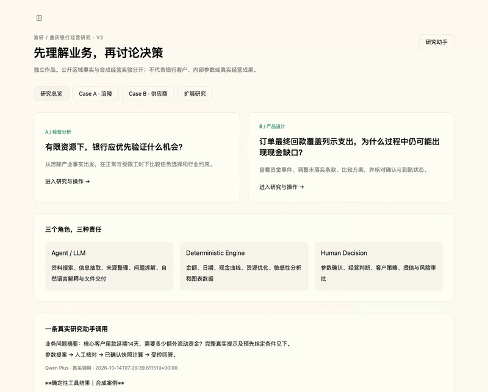

# 渝研｜银行经营分析与产品研究

面向县域客户经营与制造业供应商资金管理的个人研究与产品项目。使用公开事实建立业务背景，以合成数据开展经营实验；金融金额、日期、现金流与资源配置由确定性程序计算，AI 用于问题理解、资料整理与解释。

| 两个 Case | 要回答的业务问题 | 可以看到什么 |
|---|---|---|
| **涪陵县域经营分析** | 客户经理工时有限，先验证哪些客户经营机会？ | 公开产业事实、业务驱动估值、600h / 150h 资源取舍、分散约束下的机会成本 |
| **汽摩供应商资金管理** | 最终回款覆盖列示支出，为何过程中仍会缺现金？ | 验收与开票条件、现金曲线、预测与入账区分、实际收付与余额原子核对 |

**[▶ 3 分钟产品演示](DEMO.md)** · **[研究报告](docs/reports/README.md)** · **[源码结构](#源码结构)** · **[可复算说明](REPRODUCIBILITY.md)**

[完整概览视频 · 约 48 秒](docs/media/overview.mp4) · [涪陵演示](docs/media/fuling.mp4) · [供应商与参数确认演示](docs/media/supplier-ai.mp4)

> 个人求职作品，非重庆农商行合作项目。全部客户与订单均为合成数据；金额是模型输出，不是真实经营业绩。不提供授信决策。[数据与责任边界](DISCLAIMER.md)

## 先看经营判断，再看 AI 工具化

- **经营分析**：同余额的客户，交易频次、代发员工、合格供应链连接和既有关系价值不同，优先任务可以不同。每个动作列出驱动因素、成本、工时、待核材料和停止条件。
- **产品设计**：把“预计会收钱”“对方已确认”和“实际已到账”分开；输入观察余额不一致时，本次收付与核对全部回滚。
- **AI 工具化**：用户问题 → LLM 结构化提案 → 参数确认 → deterministic tool → 结果 → LLM 解释。最终金融回答由工具结果与受控模板约束。**Numerical correctness ≠ Semantic correctness**：算对 ALL/30 天，不代表回答了 C1/14 天。

[责任划分与架构](ARCHITECTURE.md) · [脱敏真实调用](agent-platform/frontend/public/research/trace.json)

## 源码结构

→ 查看本人实现与上游边界：[CONTRIBUTIONS.md](CONTRIBUTIONS.md)

这是完整源码作品仓库。保留已验证的 agent-ops / agent-platform 目录结构，不为展示重排 imports；依赖、运行账号与密钥由使用者在本地配置。GitHub 文档、截图与录屏即为公开展示入口，本项目不提供在线服务。

| 路径 | 作用 |
|---|---|
| [agent-ops/examples/fuling.py](agent-ops/examples/fuling.py) | 合成客群、按业务驱动估值的候选动作、工时与行业约束优化；保留明确的历史兼容代码 |
| [supplier_ledger.py](agent-ops/research/supplier_ledger.py) | 合同支付依赖、事件状态、现金曲线、原子收付核对及只读情景计算 |
| [ledger_store.py](agent-ops/research/ledger_store.py) | PostgreSQL 持久化、账户隔离、幂等、版本控制、确认快照存储 |
| [scenario_request.py](agent-ops/research/scenario_request.py) | 绑定请求、客户、参数、确认状态与账本版本 |
| [trace_guard.py](agent-ops/research/trace_guard.py) | 从成功工具结果生成受控回答，防止自由文本改写金额或状态 |
| [research frontend page](agent-platform/frontend/src/app/workspace/research/page.tsx) | 两个案例的真实交互界面；读取 Python 结果并调用账本接口 |
| [research_plugin.py](agent-ops/research_plugin.py) / [research_policy.py](agent-ops/research_policy.py) | 本项目 Agent 工具、API 扩展及回答边界 |
| [agent-ops/test_*.py](agent-ops/) | 确定性模型、合同依赖、账本、语义、发布边界与集成测试 |
| [build_data.py](agent-ops/research/build_data.py) / [build_reports.py](agent-ops/research/build_reports.py) | 标准库数据构建与报告生成 |
| [portfolio_verify.py](scripts/portfolio_verify.py) | 当前完整公开仓库的文件与冻结结果核对 |
| [agent-platform/frontend](agent-platform/frontend) / [backend](agent-platform/backend) | 完整前后端及 Agent framework 源码，不是只有页面截图 |

完整目录见 [PUBLIC_REPO_TREE.md](docs/PUBLIC_REPO_TREE.md)。上游框架来自 **DeerFlow**，本项目没有从零自研整个 Agent framework；保留 MIT 许可证及 [第三方归属说明](third_party/ATTRIBUTION.md)。

## 给技术面试官的复核入口

先按 [REPRODUCIBILITY.md](REPRODUCIBILITY.md) 运行标准库构建，再检查关键不变量：同余额不同任务、合同日期只推导 PROJECTED、余额不符全部回滚、修改输入使旧情景失效。运行本地完整平台需要 PostgreSQL 与自行配置的模型密钥；阅读文档和确定性复算不需要它们。

[截图清单](docs/screenshots/README.md) · [录屏脚本与口播](docs/media/RECORDING_SCRIPTS.md) · [秘密扫描报告](docs/SECRET_SCAN_REPORT.md) · [公开文件清单](PUBLIC_RELEASE_INVENTORY.json)

Final Release 已冻结。本公开版本以 GitHub 作品展示与本地完整复现为最终交付形态。
